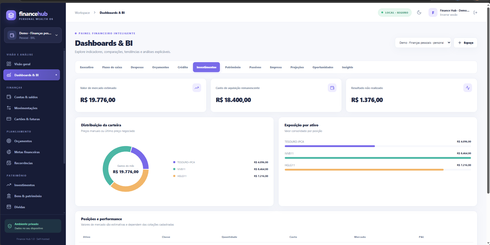
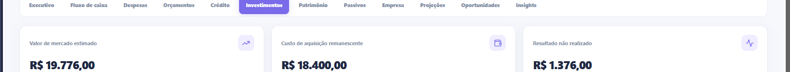
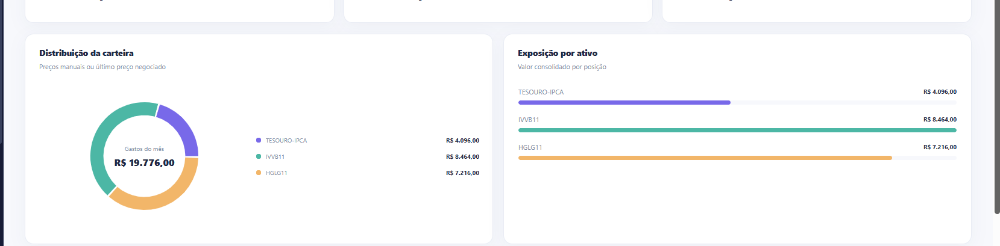
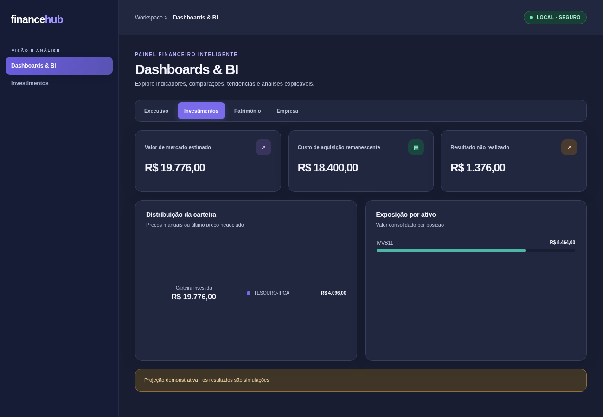

<div align="center">

# Finance Hub

**Plataforma de inteligência financeira self-hosted**  
Gestão pessoal, familiar e empresarial · Investimentos · Dashboards & BI · Automação

**Next.js 15 · React 19 · TypeScript · PostgreSQL 17 · Docker Compose**

[Instalação](#instalação) · [Demonstração](#demonstração-com-dados-fictícios) · [Dashboards](#dashboards-e-capturas) · [GitHub](#publicar-no-github) · [Segurança](#segurança-e-privacidade)

</div>

---

## Visão geral

O **Finance Hub** é um sistema local para organizar contas, transações, cartões e parcelamentos, investimentos, patrimônio, orçamentos, dívidas, receitas recorrentes e processos financeiros empresariais. Inclui **12 painéis analíticos** e dados fictícios isolados para demonstração.

Funciona em **Windows 11, macOS e Linux**, usando contêineres Linux do Docker. Para Mac com Apple Silicon, as imagens utilizadas possuem variantes ARM64; em Windows, utilize Docker Desktop com WSL2 e contêineres Linux.

> **Privacidade primeiro:** o repositório contém somente código e imagens fictícias. O usuário gera segredos e dados localmente. A instalação não publica a porta do banco nem a interface na rede externa por padrão. Não use dados financeiros reais sem testar backup/restauração, segurança e comportamento em seu equipamento.

## Dashboards e capturas

### Investimentos · interface real da demo (tema claro)



*Captura real fornecida pelo usuário da demonstração fictícia, anterior ao ajuste do rótulo central do gráfico; recortada para remover navegador e barra do sistema. O código atual já contém o ajuste.*

### Indicadores e distribuição de carteira · detalhe da demo real





*Recortes da mesma captura real da demonstração; não são dashboards adicionais.*

### Investimentos · prévia de validação do tema escuro



*Prévia de renderização dos componentes com o contraste corrigido; não é uma captura end-to-end do produto executado em Docker. Para capturas reais e atuais de todos os dashboards, veja [Gerar screenshots reais](#gerar-screenshots-reais).* 

**12 painéis de BI:** Executivo, Fluxo de caixa, Despesas, Orçamentos, Crédito, Investimentos, Patrimônio, Passivos, Empresa, Projeções, Oportunidades e Insights. Estão disponíveis nos temas claro e escuro, com filtros por espaço financeiro.

## Funcionalidades

| Domínio | Recursos |
| --- | --- |
| Financeiro | Contas, transferências, receitas, despesas, categorias, conciliação e importação CSV/OFX |
| Crédito | Cartões, compras, parcelas, faturas, limites e pagamentos |
| Planejamento | Orçamentos, metas, assinaturas e recorrências |
| Investimentos | Ativos, operações, preços manuais, posições e resultado não realizado |
| Patrimônio | Bens, ativos, passivos, empréstimos e amortizações |
| Empresa | Contatos, recebíveis, pagamentos, documentos e oportunidades |
| Analytics | Dashboards, comparações, indicadores, cenários, insights e exportação |
| Governança | Usuários, perfis, espaços isolados, logs de auditoria e operações verificáveis |
| Segurança | Sessões, hashes de senha, AES-256-GCM para campos selecionados e backups criptografados |

## Requisitos

- **Todos:** Docker Engine / Docker Desktop com **Docker Compose V2** e contêineres Linux.
- **Windows 11:** Docker Desktop + WSL2; PowerShell 5.1+ (já incluso no Windows) ou PowerShell 7.
- **macOS:** Docker Desktop (Intel ou Apple Silicon), Bash e `curl`. Para gerar segredos, use `openssl`, `python3` ou `node`.
- **Linux:** Docker Engine com plugin Compose V2, Bash, `curl` e um gerador seguro de segredos (`openssl`, `python3` ou `node`). O usuário precisa de permissão para usar Docker.
- **Para publicar no GitHub:** somente **Git + PowerShell** no Windows, ou **Git + Bash + curl** no macOS/Linux. **Não requer `gh` nem Node.js** no computador que fará a publicação.

A primeira construção baixa imagens Docker e dependências npm. Não é necessário instalar Node.js no host **para executar a aplicação via Docker**.

## Instalação

Clone o repositório e entre na pasta. Em sistemas com Bash:

```bash
git clone https://github.com/SEU_USUARIO/finance-hub.git
cd finance-hub
bash scripts/financehub.sh start
```

Abra **http://localhost:3000** e configure o primeiro administrador com o código exibido pelo instalador. Os segredos são criados em `secrets/`, fora do Git. `APP_PORT=3005 bash scripts/financehub.sh start` permite usar outra porta.

**Windows PowerShell:**

```powershell
powershell -NoProfile -ExecutionPolicy Bypass -File .\scripts\start.ps1
```

O script original do Windows permanece disponível. Para atualizar sem remover volumes, use `scripts/upgrade.ps1` (Windows) ou repita `bash scripts/financehub.sh start` (macOS/Linux).

> A instalação não recupera dados antigos se o volume tiver sido apagado. Para restaurar dados financeiros, é necessário backup válido e a chave de descriptografia correspondente.

## Demonstração com dados fictícios

Use **http://localhost:3100** para explorar um banco separado com histórico de 12 meses, cartões, investimentos, contas, orçamentos, patrimônio e transações empresariais fictícias.

**macOS / Linux:**

```bash
bash scripts/financehub.sh demo
bash scripts/financehub.sh verify-demo
```

**Windows:**

```powershell
powershell -NoProfile -ExecutionPolicy Bypass -File .\scripts\demo.ps1
powershell -NoProfile -ExecutionPolicy Bypass -File .\scripts\demo-verify.ps1
```

Usuário: `demo@financehub.local`. A **senha é gerada em cada instalação** e exibida pelo inicializador; não está no repositório.

O ambiente da demo utiliza o projeto Compose `financehub-demo`, outro volume de banco e chaves próprias. **Nunca cadastre dados reais na demo.**

Para recriar *apenas* a demo, apagando deliberadamente seus dados fictícios:

```bash
bash scripts/financehub.sh reset-demo --confirm
```

No Windows: `powershell -File .\scripts\demo.ps1 -ResetDemo -ConfirmReset`.

## Validação e CI

O GitHub Actions inclui:

- **CI** nos três sistemas (Windows, macOS e Ubuntu), para tipagem, testes e compilação com Node.js; com integração Docker de demo em Ubuntu.
- **Galeria de screenshots** real via Playwright (acionada manualmente).
- **Publicação de imagens GHCR** para `linux/amd64` e `linux/arm64` em tags `v*` (web, worker, migrate e demo seed).

Localmente, com Node.js 22+ e dependências npm instaladas, use `npm run verify`. A compilação nativa e o teste de integração Docker dependem da máquina de execução; o GitHub Actions comprovará os resultados por plataforma após a publicação.

## Segurança e privacidade

**Não versione** `secrets/`, `backups/`, bancos de dados, `.env*` contendo dados privados ou arquivos de credenciais. O `.gitignore`, o scanner de pré-publicação e as restrições de CI ajudam, mas **não substituem revisão de segurança**. Configure criptografia de disco (BitLocker, FileVault ou LUKS) para proteger todo o volume PostgreSQL em repouso.

As portas web são publicadas somente em `127.0.0.1`. Para exposição externa são necessários TLS/HTTPS, autenticação, atualização de dependências e revisão de ameaças. Consulte [SECURITY.md](SECURITY.md).

## Documentação

- [Arquitetura](docs/ARCHITECTURE.md)
- [Execução multi-OS](docs/MULTIOS.md)
- [Demonstração](docs/DEMO.md)
- [Segurança e privacidade](SECURITY.md)
- [Validação funcional](docs/VALIDATION.md)
- [Histórico das versões anteriores](docs/RELEASE-HISTORY.md)
